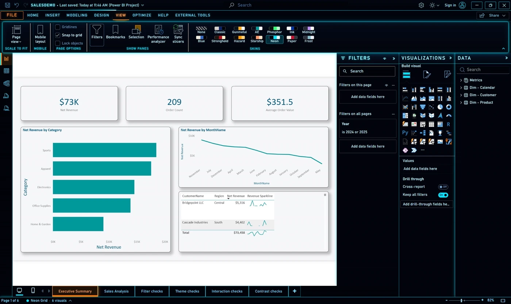
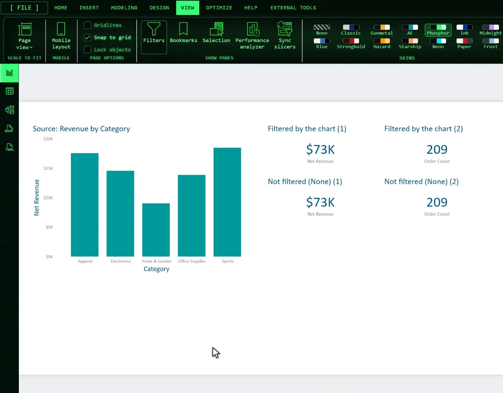
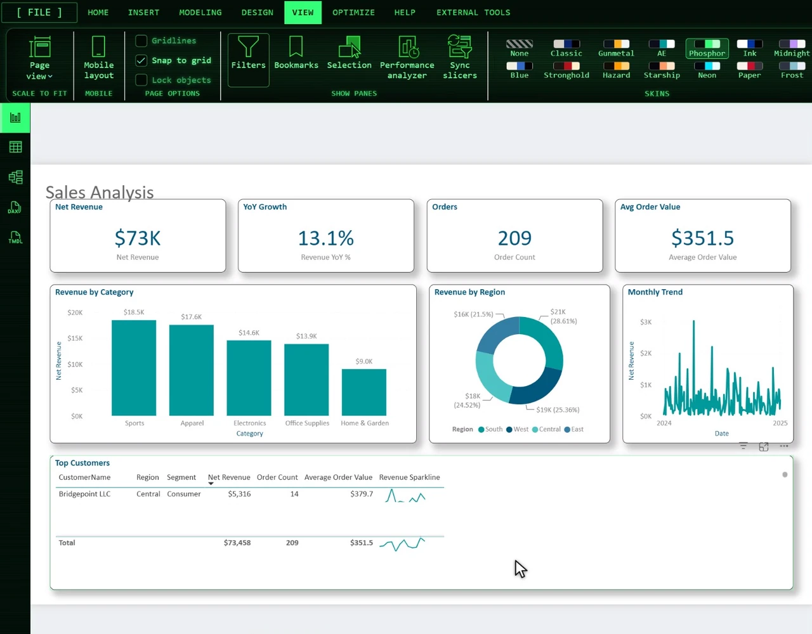
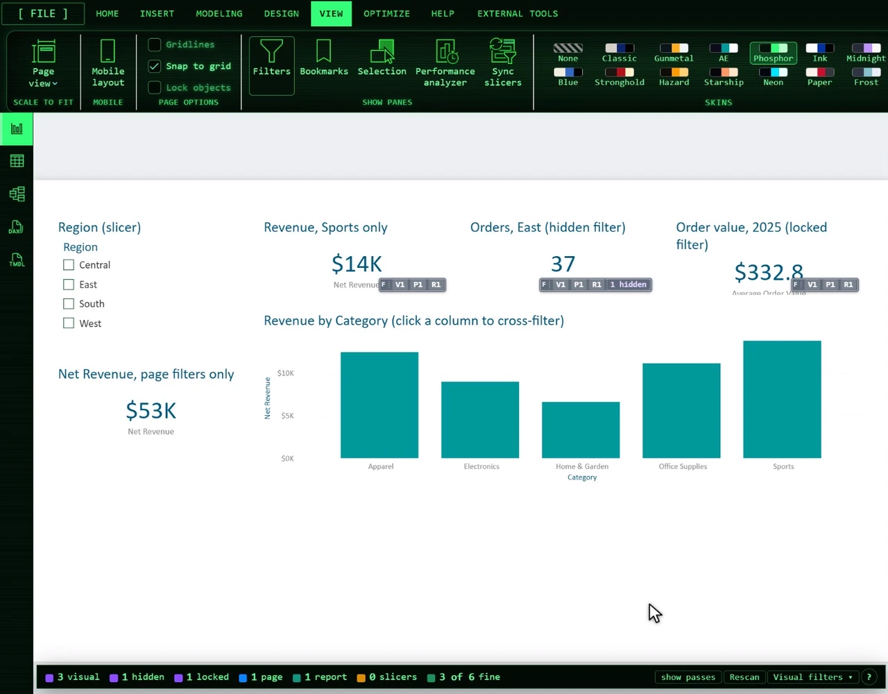
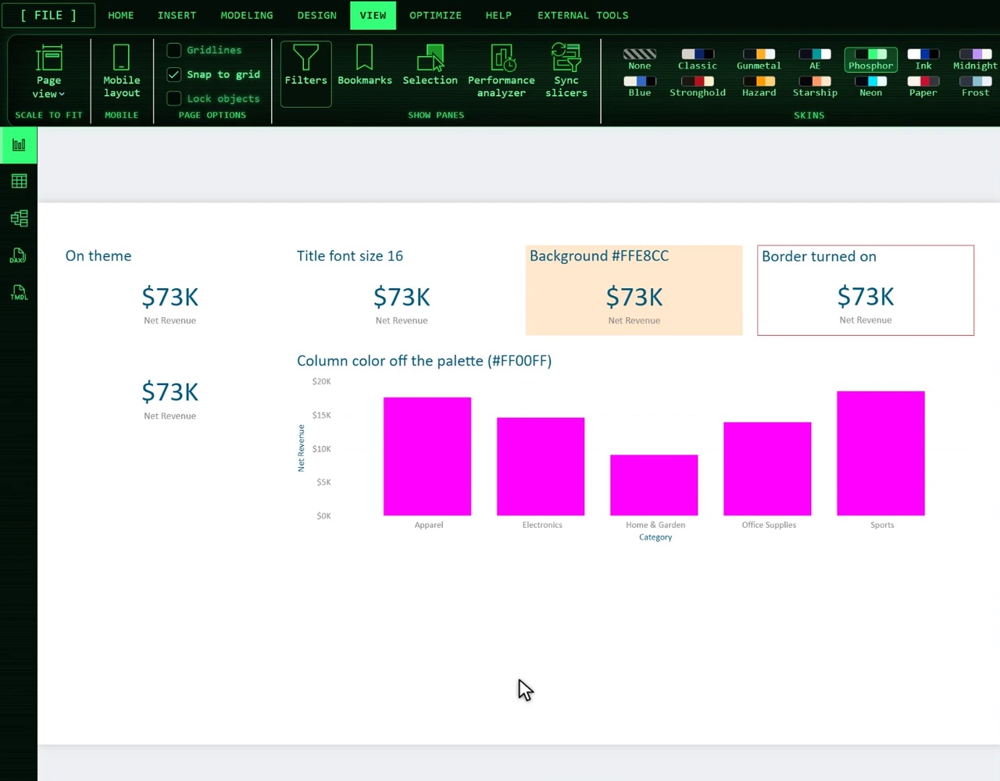
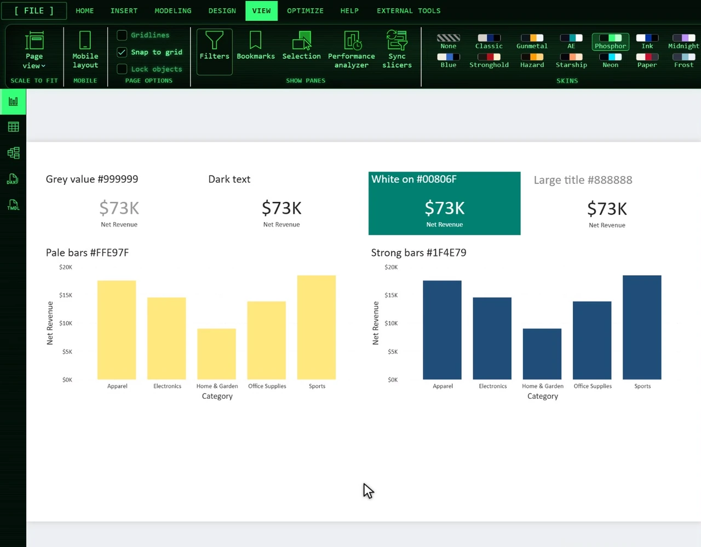
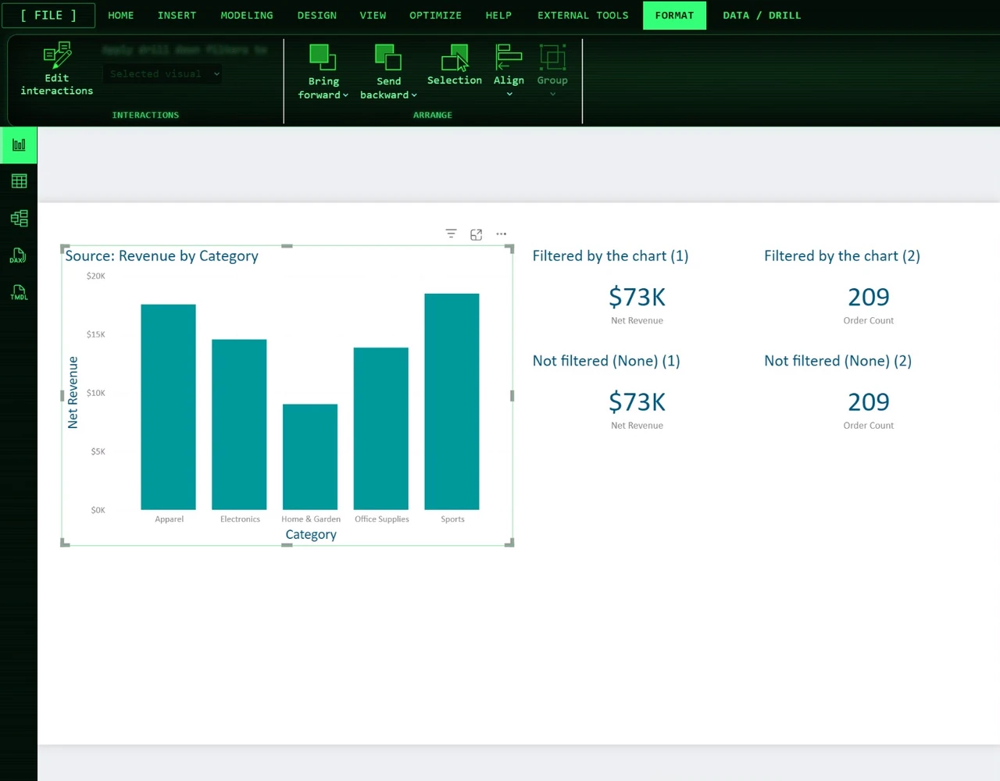
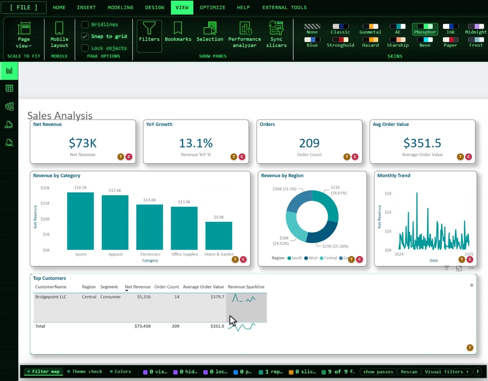

# Skins & Tools for Power BI

A [Windhawk](https://windhawk.net) mod for Power BI Desktop. It restyles the whole Power BI
Desktop window with one of 13 skins and adds a set of tools for report authors: Stencil,
Layout QA, Filter map, Theme check, Colors and an overlay for Edit interactions.

A skin never changes your report. It covers the app around the report (title bar,
ribbon, panes, page tabs, status bar, the Table, Model, DAX query and TMDL views, dialogs), and
the report page and its visuals look exactly as your report theme says. The tools draw on top of
the page and leave the report alone unless you ask them to change something.

Power BI is a trademark of Microsoft. This project is not affiliated with or endorsed by Microsoft.

This repository holds the built mod, its demo media and these docs. Each
[release](https://github.com/ae-reid-havens/skins-tools-for-power-bi/releases) carries the mod
file to paste into Windhawk.

## Skins

*Picking a skin from the Skins group on the View ribbon.*

| Skin | Look |
|-|-|
| Blue Hills | Glossy blue title bar, beige chrome, a blue task-pane rail |
| Classic Grey | Grey 3D bevels, a navy gradient title bar, square corners |
| Stronghold | An iron band with rivets, a stone wall, red banner tabs, a bronze-framed ribbon |
| Gunmetal Console | Blue-grey steel plates with chamfers and rivets, amber readouts, scanlines |
| Hazard Suit | An amber HUD on black with a glow and corner brackets |
| Analytic Endeavors | Navy ground, a teal action color, an orange accent |
| Starship Panel | A black ground with pill buttons in orange, lilac, periwinkle and peach |
| Phosphor Terminal | One-color green phosphor, scanlines, glow, a blinking cursor |
| Neon Grid | Black space, glowing neon cyan edges, orange for the chosen item |
| High Contrast Ink | Black on white, every word at 7:1 contrast or better, a yellow focus ring, UI text a size up |
| Graph Paper | Warm off-white paper, a faint blue grid, pencil-grey text, red pen for the chosen item |
| Midnight Orchid | Deep blue-grey night, soft white text, purple structure, pink for the chosen item |
| Arctic Frost | Polar-night panes, snow-white text, frost-blue accents |

To pick one, open the **View** tab: a **Skins** group sits at the end of the ribbon. The status
bar also gets a small chip with the skin name and the page's visual count; click it, or press
**Ctrl+Alt+K**, for the menu. **Ctrl+Alt+]** and **Ctrl+Alt+[** step through the skins.
**None** puts Power BI back exactly as it was.

A skin covers the Report, Table, Model, DAX query and TMDL views and Power BI's dialogs, and
picking one in any view updates the others.
Skins look the same over Power BI's light and dark modes. The Filters pane is painted like the
other panes; turn on **Keep the report's Filters pane colors** while you design the report's own
filter pane formatting.

Everything is drawn with CSS gradients and Windows fonts, with no images. Midnight Orchid and
Arctic Frost take their colors from the MIT-licensed Dracula and Nord color schemes.

## Tools for report authors

The tools sit at the top of the menu, grouped by job: Plan (Stencil), Layout (Layout QA), Check
(Filter map, Theme check, Colors) and While editing (Interactions). Each has its own key, and most
add a strip under the page with their counts and switches.

### Stencil (Ctrl+Alt+S)

*Drawing a page layout as blocks before building it.*

A see-through mock-up layer on the report page, for laying a page out before you build it. **Edit**
turns the page into a drawing surface: pick a type (card, column, bar or line chart, table,
slicer, title, text), drag to draw a block or click for its usual size, drag to move, pull a
handle to resize. Edges snap to the Layout QA grid and to the edges of visuals and other blocks.
While you edit, the page takes no clicks; **Done** or Esc gives them back. Blocks are saved per
report and page.

The **Build** menu has **Copy build script**, which puts a PowerShell script on the clipboard.
Save the report, paste the script into PowerShell, then click **Apply external changes** in the
bar Power BI shows: the blocks arrive as real visuals with no fields, titled with their labels.
The script writes only new files into the report project folder and never overwrites one that
exists. **Copy page into stencil** turns the page's visuals into blocks for a redesign, and
**Copy as SVG** puts the blocks on the clipboard at report size, ready for Figma.

### Layout QA (Ctrl+Alt+G)

*The grid, the labels and the red marks on a page with a few edges out of line.*

A grid and rulers in report pixels over the page, and a label on every visual with its type,
position and size. Red marks an edge a few pixels off a line other visuals share, a gap almost the
same as the page's usual gap, or a visual past the page edge; a dashed guide shows where the edge
belongs. Amber marks an edge off the grid, which is what Snap to grid keeps. The strip under the
page has the counts, a grid picker (4, 8, 10, 16 or 20 px) and the grid check switch.

Hover a label for the visual's card: its figures, each finding in words, and the value that fixes
it. Click a label to copy `x, y, w, h`; Shift+click copies the suggested values, ready for the
Format pane. Hover a visual for its distance to the nearest neighbour or the page edge in each
direction, and the edges it shares with others.

### Filter map (Ctrl+Alt+F)

*Each visual's filters by level, with the list on hover.*

A badge on every visual with its visual, page and report filters and its slicers and
cross-filters, spelled out on hover. Hover it for the list, with hidden and locked filters marked.
A menu (in the strip, and beside "Filters on this visual" in the Filters pane) hides, shows, locks
or unlocks every visual-level filter on the selected visual, on the page, or on every page. The map
updates by itself when a filter, slicer or cross-filter changes.

With the report project folder set (see Settings), each visual's own filters come from the saved
report. Without it, a visual's own filters are read once it is selected, and **Read each visual**
in the strip steps through the page for you.

### Theme check (Ctrl+Alt+T)

*Visuals whose formatting differs from the report theme.*

A badge on every visual that sets its formatting differently from the report theme: "3 differ from
theme", colors outside the theme included. The card lists each setting with the value the theme
gives it. Settings the theme leaves open, where most of the page uses another value, are grey
information and off by default. This uses the report project folder setting; without it, the
check compares what each visual draws with most of the page. The project files are read when Power
BI starts and when the mod's settings change, so after you save, restart Power BI (or touch the
setting) to check your latest changes.

### Colors (Ctrl+Alt+L, or Ctrl+Alt+A)

*Text that is hard to read and colors off the palette, numbered and outlined on the page.*

One badge on every visual whose text, bars, lines or points are hard to read against what is
behind them (WCAG 2.1 AA or AAA, picked in the strip), or that draws colors off the palette. The
palette is the report theme's colors when the report project folder is set, otherwise Power BI's
default theme colors, unless you type your own in the mod's settings. Hover the badge for each
finding, numbered and outlined on the page. Each stray color is also a swatch on the badge: point
at it to outline every part drawn in it, click it to copy the hex.

Power BI's default grey for axis labels, legends and card category labels (#888888 on white) is
3.54:1, below AA for normal-size text, so expect those flags on an untouched report. Not checked:
text over an image or a gradient, text a custom visual draws into a canvas, and the rest of
accessibility (alt text, tab order, color-only meaning).

### Interactions (Ctrl+Alt+I, on by default)

*Edit interactions with every icon colored and the bar above the selected visual.*

Shows only while Edit interactions is on (select a visual, then Format > Edit interactions). The
active interaction icon on every other visual gets a color (None red, Filter blue, Highlight
green), and a bar above the selected visual sets every other visual to None, Filter or Highlight
in one click. The bar clicks Power BI's own icons, so Ctrl+Z undoes it.

### Badges and the dock

*Several check tools on at once: one tab per tool in the dock, and the other tools' badges shrunk
to dots.*

The check tools put their badges in one row under each visual's bottom right corner, each led by
its tool's letter (F, T, C). A badge's color is its severity only: red to fix, amber to look at,
grey for information, green for a pass while "show passes" is on. With two or more check tools on,
the dock under the page has a tab per tool. The tool whose tab is shown draws full badges; the
others shrink to a dot with their letter and grow back to full size under the pointer.

## Install

You need Windows, Power BI Desktop (the installer or the Microsoft Store build) and
[Windhawk](https://windhawk.net).

From Windhawk's catalog:

1. Open Windhawk and choose **Explore**.
2. Search for "Skins & Tools for Power BI" and click **Install**.

From a release, if the catalog does not have it yet or you want an earlier version:

1. Download `pbid-tweaks.wh.cpp` from the
   [latest release](https://github.com/ae-reid-havens/skins-tools-for-power-bi/releases/latest)
   (or from the release you want).
2. In Windhawk, choose **Create a New Mod**, replace everything in the editor with the file's
   contents, click **Compile Mod**, then **Exit Editing Mode**.

Then start Power BI Desktop. The mod adds its script as Power BI opens each view, so restart Power
BI if it was already open.

Each release has two files. `pbid-tweaks.wh.cpp` is the readable mod, the same file as the
catalog's. `pbid-tweaks.min.wh.cpp` is the same mod with its page code minified, for a smaller
file; use one or the other, not both.

## Keys

| Keys | What |
|-|-|
| Ctrl+Alt+K | Open the menu: tools, skins, extras, help |
| Ctrl+Alt+H | Help: what every mark means, the extras, every key and setting |
| Ctrl+Alt+] / [ | Next / previous skin |
| Ctrl+Alt+S | Stencil |
| Ctrl+Alt+G | Layout QA |
| Ctrl+Alt+F | Filter map |
| Ctrl+Alt+T | Theme check |
| Ctrl+Alt+L or Ctrl+Alt+A | Colors |
| Ctrl+Alt+I | Interactions |
| Ctrl+Alt+C | Confetti |
| Esc | Close the menu, the help or a tooltip |

## Extras

Switches in the menu, most with a **Try** button: a splash when a skin is picked, a short note
when a visual shows an error or a refresh finishes, confetti in the skin's shapes when a refresh
finishes, skin sounds (a few synthesized notes, off by default), the visual count in the status
bar chip (amber past 20), and the Konami code. You can also name a sound file of your own to play
with the confetti (see Settings). The mod carries no audio files.

## Settings

In Windhawk, open the mod's **Settings** tab. A choice you make inside Power BI (a skin, a switch,
a tool's option) wins until these settings change; then the settings apply.

| Setting | What it does |
|-|-|
| Skin | The skin to use until you pick another inside Power BI (default: None) |
| Splash, notes, confetti, skin sounds | The extras, each on or off (skin sounds start off) |
| Sound file for the refresh confetti | Full path to an .mp3, .wav, .ogg or .m4a under 2 MB, played with the confetti; empty for none |
| Report project folder | The `.Report` folder of a report saved as a Power BI project (or its `.pbip` file), for the theme check, the filter map and the palette from the report theme; empty for none |
| Visual count in the status bar | The page's visual count on the status bar chip |
| Keep the report's Filters pane colors | Leaves the Filters pane in the report's own colors under a skin |
| Layout QA grid | The grid Layout QA draws and checks, in report pixels (default 8, as Power BI's Snap to grid) |
| Layout QA marks edges off the grid | The amber marks; turn off for pages not built on a grid |
| Layout QA near-miss range | How close to a neighbour's edge, or to the page's usual gap, counts as off (default 8 px) |
| Palette for Colors | Your own hex colors, separated by commas or spaces; empty for the theme's or Power BI's defaults |
| Palette tolerance | How far each color channel (0 to 255) may stray and still count as on the palette (default 12) |

## What it reads and keeps

- **Files:** the mod reads files for two settings only. "Report project folder" reads that
  report's own JSON files (every `.json` under its `definition` and `StaticResources` folders,
  up to 1 MB a file and 8 MB in all) when Power BI starts and when the settings change. "Sound
  file for the refresh confetti" reads that one audio file. The mod writes no files.
- **Stencil's build script** is put on the clipboard and changes nothing by itself. Only when you
  paste and run it does it write into the report project folder: new visual files, and for a new
  page its `page.json`, with `pages.json` backed up to a `.stencil-backup` folder beside the
  `.Report` folder before it is updated to list the page. It never overwrites a file that exists.
- **Browser storage:** choices made inside Power BI (the skin, the switches, each tool's settings,
  Stencil blocks) are kept in the Power BI page's own localStorage under the key `pbid-skins`.
  Conveniences for you (folded menu sections, the last help tab, the dock tab, the one-time menu
  hint) are kept under `pbid-skins-ui`. Disabling the mod takes the skins and tools out of the open
  window and leaves both keys for next time.
- **Clipboard:** the mod writes to it only when you click a copy action (a Layout QA label, a
  color swatch, Copy build script, Copy as SVG) and never reads it.

## Privacy

Everything runs locally, inside Power BI Desktop. The mod loads only into `PBIDesktop.exe`, and its
script runs only in Power BI's own top-level page, not in custom visuals, sign-in pages or anything
else embedded there. It makes no network requests, has no telemetry and sends nothing anywhere.

The readable mod file is not obfuscated, so you can see what it does before you install it.

## When something looks wrong

Power BI changes its interface often. If an update leaves something looking wrong, pick **None**
in the Skins group or the menu, which puts Power BI back exactly as it was, or disable the mod in
Windhawk.

## License

CC BY-ND 4.0 from version 1.0.1, see [LICENSE](LICENSE). Use it, at work too, and share unchanged
copies, as long as you credit Reid Havens and link the license. Modified or rebranded versions
may not be shared. Version 1.0.0 was released under the MIT License.

The skin names and the "Skins & Tools for Power BI" name belong to this project.
